<!-- Pictures are generated by scripts/build.mjs, and this file by scripts/readme.mjs. Edit those, then run: npm run build -->

<picture><source media="(prefers-color-scheme: dark)" srcset="assets/hero-dark.svg"></picture>

I'm a tech lead and AI systems architect in Agadir. At **[Ton avenir au maroc](https://baalla.tech/about.html)** I lead the design and build of the **TAM Digital Platform**, a multi-company system for operations, collaboration and automation, from the first schema to the last deploy. My favourite part is still the middle, where product thinking, interface design and clean architecture meet.

<a href="https://baalla.tech/"><picture><source media="(prefers-color-scheme: dark)" srcset="assets/btn-portfolio-dark.svg"></picture></a>
<a href="https://www.linkedin.com/in/abdelhakimbaalla/"><picture><source media="(prefers-color-scheme: dark)" srcset="assets/btn-linkedin-dark.svg"></picture></a>
<a href="mailto:abdelhakimbaalla50@gmail.com"><picture><source media="(prefers-color-scheme: dark)" srcset="assets/btn-email-dark.svg"></picture></a>
<a href="https://baalla.tech/assets/pdf/CV-Abdelhakim-Baalla.pdf"><picture><source media="(prefers-color-scheme: dark)" srcset="assets/btn-cv-dark.svg"></picture></a>
<a href="https://x.com/Abdelhakim99891"><picture><source media="(prefers-color-scheme: dark)" srcset="assets/btn-x-dark.svg"></picture></a>
<a href="https://www.youtube.com/@Dinocrafting"><picture><source media="(prefers-color-scheme: dark)" srcset="assets/btn-youtube-dark.svg"></picture></a>

 

<picture><source media="(prefers-color-scheme: dark)" srcset="assets/head-work-dark.svg"></picture>

<a href="https://github.com/Abdelhakim-Baalla/Mahsoul"><picture><source media="(prefers-color-scheme: dark)" srcset="assets/work-mahsoul-dark.svg"></picture></a>

<a href="https://github.com/Abdelhakim-Baalla/LBaraka"><picture><source media="(prefers-color-scheme: dark)" srcset="assets/work-lbaraka-dark.svg"></picture></a>

<a href="https://github.com/Abdelhakim-Baalla/WealthWave"><picture><source media="(prefers-color-scheme: dark)" srcset="assets/work-wealthwave-dark.svg"></picture></a>

<a href="https://github.com/Abdelhakim-Baalla/omarchy-salat-times"><picture><source media="(prefers-color-scheme: dark)" srcset="assets/work-salat-dark.svg"></picture></a>

<a href="https://github.com/Abdelhakim-Baalla/quantum-vqe-chemistry-lab"><picture><source media="(prefers-color-scheme: dark)" srcset="assets/work-quantum-dark.svg"></picture></a>

<a href="https://github.com/Abdelhakim-Baalla/Athkar-bot"><picture><source media="(prefers-color-scheme: dark)" srcset="assets/work-athkar-dark.svg"></picture></a>

There is more in [the archive](https://github.com/Abdelhakim-Baalla?tab=repositories): Minecraft mods, Arduino sketches, a Godot rogue-lite, and a growing shelf of CodinGame solvers.

 

<picture><source media="(prefers-color-scheme: dark)" srcset="assets/head-path-dark.svg"></picture>

<picture><source media="(prefers-color-scheme: dark)" srcset="assets/path-dark.svg"></picture>

 

<picture><source media="(prefers-color-scheme: dark)" srcset="assets/head-stack-dark.svg"></picture>

<picture><source media="(prefers-color-scheme: dark)" srcset="assets/stack-dark.svg"></picture>

I work in Arabic and Tamazight (native), English (professional) and French (intermediate).

 

<picture><source media="(prefers-color-scheme: dark)" srcset="assets/head-proof-dark.svg"></picture>

Fifteen certifications so far. The recent ones follow the work: **Quantum Machine Learning** from IBM, the **Google AI Professional Certificate**, and three from Anthropic on **Claude Code** and the **Model Context Protocol**.

All fifteen, newest first

 

| Certification | Issuer | Issued |
| :-- | :-- | :-- |
| Quantum Machine Learning | IBM | Oct 2026 |
| Google AI Professional Certificate | Google | Jun 2026 |
| Arduino: Foundations | LinkedIn Learning | Apr 2026 |
| Claude Code in Action | Anthropic | Jan 2026 |
| Model Context Protocol: Advanced Topics | Anthropic | Jan 2026 |
| Introduction to Model Context Protocol | Anthropic | Jan 2026 |
| MongoDB (Beginner Level) | Satr (Tuwaiq) | Oct 2025 |
| Postman API Fundamentals Student Expert | Postman | Mar 2025 |
| SQL (Basic) Certificate | HackerRank | Dec 2024 |
| Foundational C# with Microsoft | Microsoft & freeCodeCamp | Jul 2024 |
| Network Programming | Satr (Tuwaiq) | Feb 2024 |
| PHP Basics | Satr (Tuwaiq) | Feb 2024 |
| SQL | Satr (Tuwaiq) | Dec 2023 |
| JavaScript Algorithms and Data Structures | freeCodeCamp | Jun 2023 |
| Responsive Web Design | freeCodeCamp | Jun 2023 |

Each one can be verified on [LinkedIn](https://www.linkedin.com/in/abdelhakimbaalla/details/certifications/).

 

<picture><source media="(prefers-color-scheme: dark)" srcset="assets/head-year-dark.svg"></picture>

<picture><source media="(prefers-color-scheme: dark)" srcset="assets/year-dark.svg"></picture>

Drawn from the GitHub API and redrawn every morning by <a href=".github/workflows/readme.yml">a workflow in this repository</a>.

 

<a href="https://baalla.tech/"><picture><source media="(prefers-color-scheme: dark)" srcset="assets/close-dark.svg"></picture></a>

Open to ambitious collaborations, technical partnerships and select freelance builds. Tell me the shape of the problem; if it is not a fit, I will say so and point you somewhere better.

<a href="mailto:abdelhakimbaalla50@gmail.com?subject=Hello%20Abdelhakim"><picture><source media="(prefers-color-scheme: dark)" srcset="assets/btn-hello-dark.svg"></picture></a>
<a href="https://baalla.tech/services.html"><picture><source media="(prefers-color-scheme: dark)" srcset="assets/btn-services-dark.svg"></picture></a>

